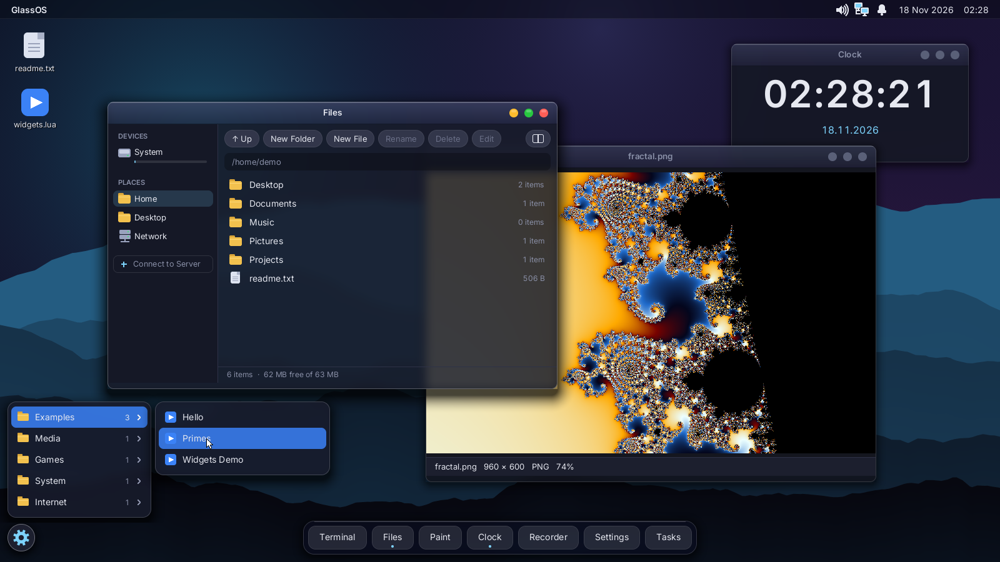
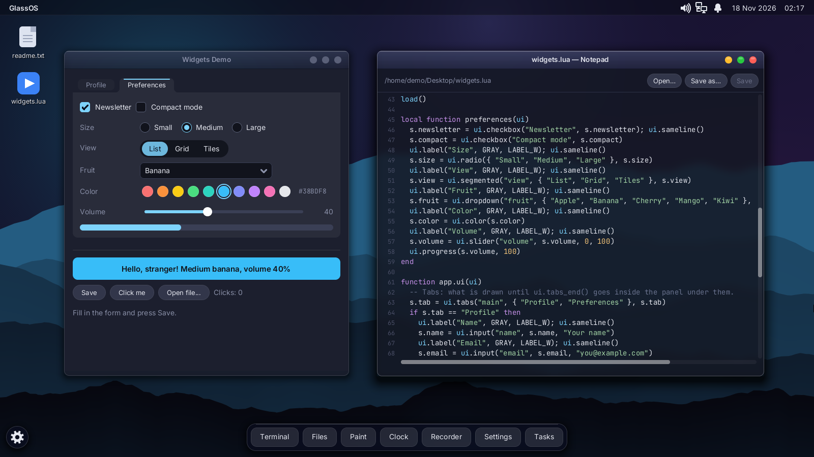
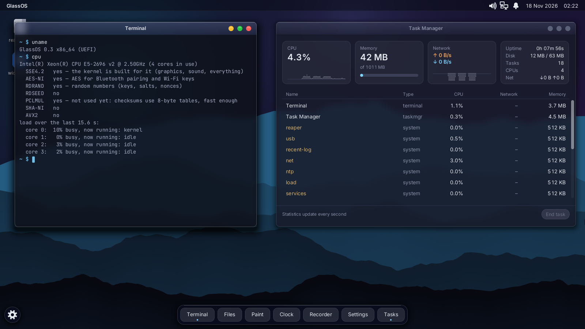
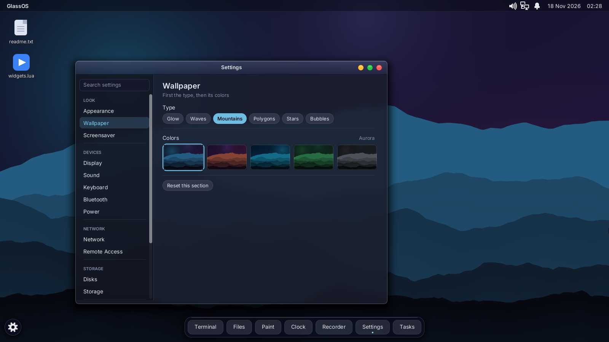
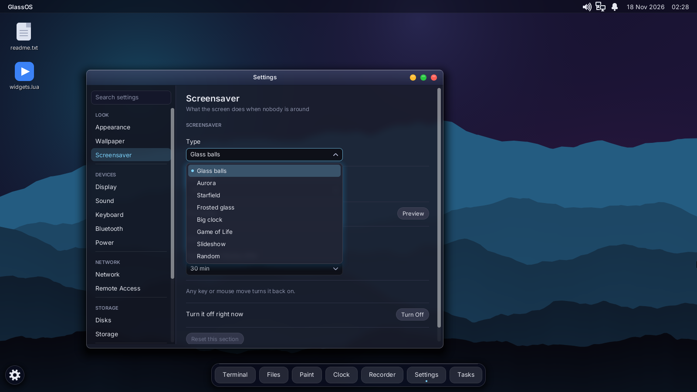
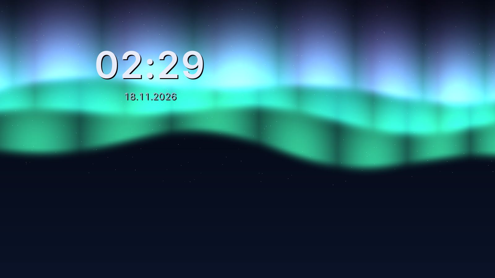
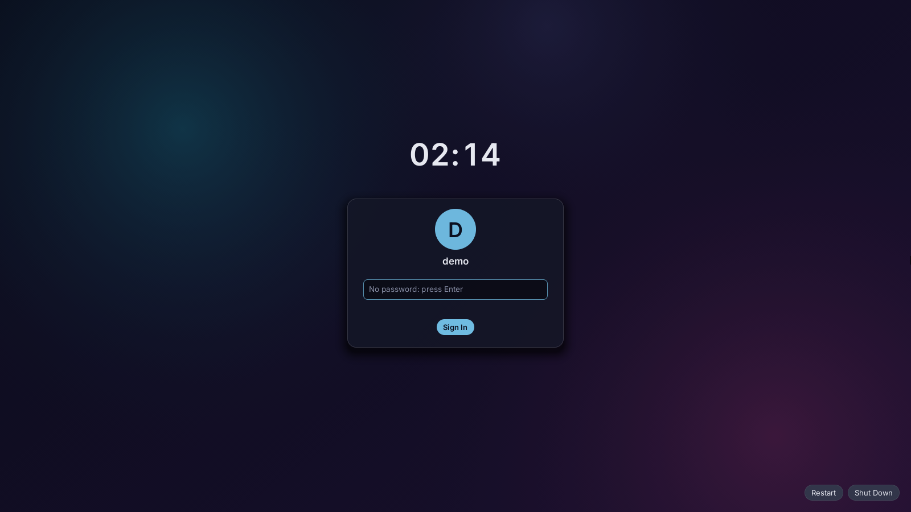

# Screenshots

GlassOS in a QEMU virtual machine at 1600×900, a fresh install with one account. Everything on
the screen is drawn by GlassOS itself: the windows, the fonts, the blur behind the glass and the
wallpapers, which are generated, not image files. Some screenshots show features that land in the
next release.

## The desktop

The program menu (the gear) groups programs by category. Files and the image viewer
sit on the Mountains wallpaper, and the frosted glass of each window blurs whatever lies behind it.

## A Lua application and its source

Programs are Lua files: no compiler, no build step. On the left is the Widgets Demo, on the right
its own source in Notepad. Each `ui.*` call draws one widget and returns its new value. See the
[Lua API](lua-api/00-getting-started.md).

## Task Manager and the terminal

Task Manager shows CPU, memory and the network (sent above the centre line, received below),
with every process and kernel thread. The terminal is the built-in shell; `cpu` lists the
processor's features and the load of each core.

## Settings

Every subsystem has its own page. Wallpapers come in six types, each in five colour variants.

Native drop-down lists, here the screensaver type:

## A screensaver

Aurora, one of seven screensavers; the others include a starfield, Game of Life and a slideshow
of a picture folder.

## Sign-in

